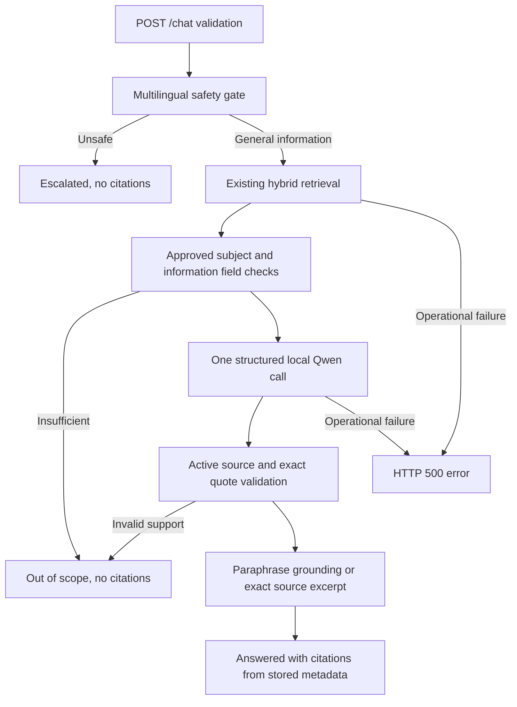

# System Architecture

The existing FastAPI application owns the public contract. Its request-scoped
`ChatService` composes the existing retrieval classes and a small HTTPX Ollama
chat client. There is no separate application, agent framework, or database.

See [Stage 4A](../stage4a.md) for function-level behavior, limits, and measurements.

## Stage 5 browser client

`frontend/` contains the React/Vite/TypeScript client. Component state stores only
the visible conversation. A fetch layer posts `{message, session_id:null}` to
`/api/chat`; Vite forwards that request to the existing FastAPI `/chat` route.
There is no second backend or server history. Backend answers/citations remain
authoritative; the frontend presents status, direction, source disclosure, loading,
and technical failures. See [Stage 5](../stage5.md) for components and verification.
